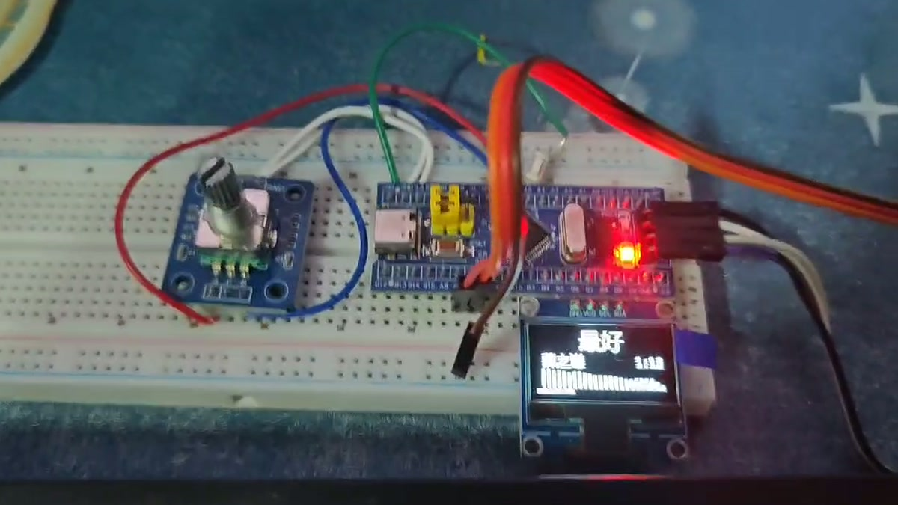
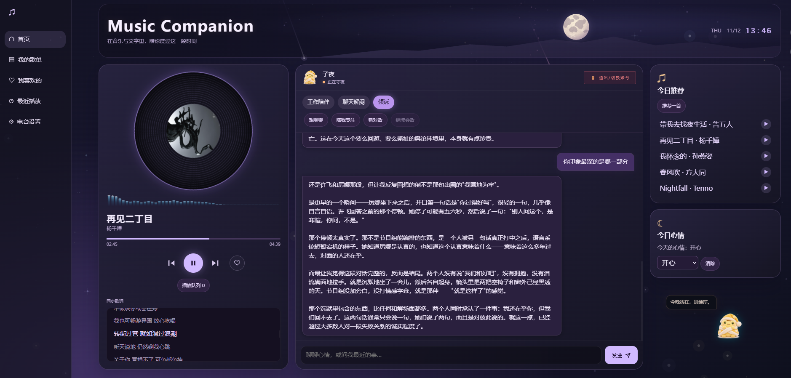
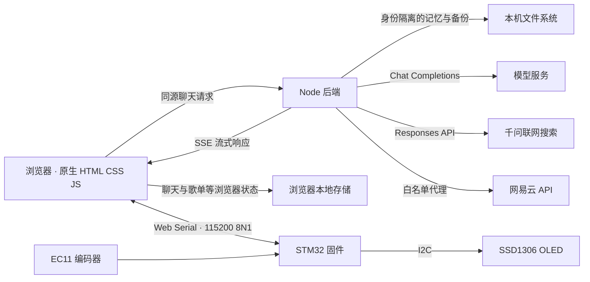

# Music Companion

Music Companion 是一个运行在个人电脑上的 AI 音乐陪伴项目，AI 助手名为「子夜」。它把流式对话、自然语言点歌、播放队列、智能歌单和长期记忆放在同一个电台界面里；接上 STM32 硬件终端后，歌名、进度和实时频谱会显示在实体 OLED 上，还能用旋钮调音量、暂停、切歌。

前端使用原生 HTML、CSS 和 JavaScript，Node.js 后端对接 OpenAI 兼容的模型接口与网易云音乐服务；固件基于 STM32F103C8T6 与 FreeRTOS，通过 Web Serial 与网页通信。

## 实机演示

[](docs/media/hardware-demo.mp4)

17 秒实拍（无声）：网页播放歌曲后，OLED 显示中文歌名、歌手、时间、进度条与 24 柱实时频谱；转动编码器调音量，按下暂停/继续，快速按两下切歌。

## 界面预览



## 两种用法

| 用法 | 需要 | 能得到 |
|---|---|---|
| 纯网页 | Node.js + 一个模型 API Key | 完整的对话、点歌、歌单、记忆与备份功能，界面里播放与查看 |
| 网页 + 硬件终端 | 上面这些，外加一块 STM32F103C8T6 + SSD1306 OLED + EC11 编码器 + CH340 | OLED 跟随播放显示歌名/进度/频谱，实体旋钮控制音量与播放；接线与烧录见[硬件文档](docs/hardware.md) |

硬件部分是可选的：不接硬件时，网页应用与 1.0.0 版本功能一致。

## 快速开始

### BYOK 与 API 安全

Music Companion 采用 BYOK（Bring Your Own Key）。项目不提供公共 API Key。每位使用者都需要向自己的模型服务商申请 Key，并自行承担调用费用。

按本教程配置时，API Key 只保存在用户本机的 `.env` 中，由 Music Companion 服务端读取。项目不会要求你把 Key 提交到 GitHub。公开发布时，配置文件只上传 `.env.example`，真实 `.env` 留在本机。请勿把 Key 写进源码、把 `.env` 发给其他人，或在截图、录屏和日志里暴露 Key。

### 先确认 API Key 的签发平台

> **API Key 由哪个平台签发，就使用该平台对应的 API Base URL。** 模型名称含有 DeepSeek，只表示你选择了 DeepSeek 模型。比如在千问 AI 平台申请的 Key，需要发给千问 AI 平台的接口。

| Key 的签发平台 | 在 Music Companion 中填写的 Base URL |
| --- | --- |
| 千问 AI 平台（按量计费） | `https://maas.qianwenaiapi.com/compatible-mode/v1`。如果使用 Token Plan，按其专用 Key 的官方文档填写对应地址。 |
| DeepSeek 官方平台 | `https://api.deepseek.com`，即官方文档的 OpenAI 兼容地址。Music Companion 现有的默认 Base URL 是 `https://api.deepseek.com/v1`。 |
| 其他 OpenAI 兼容平台 | 使用该平台官方文档为你的 Key 提供的 Chat Completions Base URL，并确认所选模型支持流式回复。 |

地址以服务商文档为准。保留服务商要求的版本路径，例如 `/compatible-mode/v1`。Music Companion 会在 Base URL 后添加 `/chat/completions`，并在请求头里为 Key 添加 `Bearer`。配置时只填基础地址和 Key 本身。 [千问 AI 平台 OpenAI 兼容接口](https://platform.qianwenai.com/docs/api-reference/toolkitframework/openai-compatible/overview) · [千问 Token Plan](https://platform.qianwenai.com/docs/token-plan/team/token-plan-team-quickstart) · [DeepSeek 官方 API](https://api-docs.deepseek.com/en/)

### Windows 配置与启动

**环境要求**：Node.js 22.12.0 或更新版本，推荐 Node.js 24.x。从 [Node.js 官方下载页](https://nodejs.org/en/download) 选择 24.x 的 Windows Installer（`.msi`），并按电脑架构选择 x64 或 ARM64。安装后重新打开 PowerShell，确认版本：

```powershell
node -v
npm.cmd -v
```

1. **下载项目并安装依赖。** 在 GitHub 仓库页面选择「Code → Download ZIP」，解压到自己可写的目录。用文件资源管理器打开包含 `package.json` 的文件夹，在地址栏输入 `powershell` 并回车。在该窗口运行：

   ```powershell
   npm.cmd ci
   ```

   等安装完成后再配置。以后更新项目或切换 Node.js 版本，可在该目录再次运行 `npm.cmd ci`。
2. **复制配置模板。** 只有第一次配置且没有 `.env` 时才运行以下命令。如果已有 `.env`，直接跳到下一步，避免覆盖原有设置。

   ```powershell
   Copy-Item .env.example .env
   ```

3. **打开配置文件。**

   ```powershell
   notepad .env
   ```

4. **填写三项配置。** 下方是千问 AI 平台按量计费示例。把 `在千问平台申请的API_KEY` 换成你自己的 Key，并确认账号可以调用 `deepseek-v4-pro`。如果 Key 来自其他平台，按上表使用该平台的地址和模型 ID。在模板对应的三行填写配置。

   ```ini
   DEEPSEEK_API_KEY=在千问平台申请的API_KEY
   DEEPSEEK_MODEL=deepseek-v4-pro
   DEEPSEEK_BASE_URL=https://maas.qianwenaiapi.com/compatible-mode/v1
   ```

5. **保存并关闭记事本。** 按 `Ctrl+S` 保存为现有的 `.env` 文件。
6. **启动项目。** 回到 PowerShell。网页服务和内置音乐服务默认绑定本机回环地址。也可以直接双击项目目录里的 `启动.cmd`。

   ```powershell
   npm.cmd start
   ```

7. **打开网页并验证。** 保持 PowerShell 窗口打开，访问 [http://localhost:8080](http://localhost:8080)。如果无法打开，试 [http://127.0.0.1:8080](http://127.0.0.1:8080)。发送「只回复 OK」，收到模型回复即表示配置生效。修改 `.env` 后，在运行服务的窗口按 `Ctrl+C` 停止，再执行 `npm.cmd start`。刷新浏览器无法重新加载服务端配置。

### Windows 启动排查

| 现象 | 操作 |
| --- | --- |
| PowerShell 找不到 `node` 或 `npm.cmd` | 完成 Node.js 安装后关闭并重新打开 PowerShell，再运行 `node -v` 和 `npm.cmd -v`。 |
| 提示 Node 版本过低、`ERR_REQUIRE_ESM` 或 `ERR_PACKAGE_PATH_NOT_EXPORTED` | 运行 `node -v` 和 `where.exe node`。安装 Node 24.x，确保新窗口使用更新后的版本，再执行 `npm.cmd ci`。如果为当前窗口设置过禁用 `require(ESM)` 的 Node 选项，请移除该选项后重新启动。 |
| 网页打不开 | 保持运行 `npm.cmd start` 的窗口打开，确认网页服务已启动。默认网页端口为 8080，网易云子服务端口为 3000。端口冲突时见下方的本机配置。 |

### API 环境变量

| 环境变量 | 作用 |
| --- | --- |
| `DEEPSEEK_API_KEY` | 用户自己的 API Key。这个名字是 Music Companion 的内部变量名，千问和其他兼容平台的 Key 也填在这里。 |
| `DEEPSEEK_MODEL` | 账号可调用的模型 ID。服务端未配置时默认 `deepseek-chat`，上方千问示例使用 `deepseek-v4-pro`。请以签发平台列出的可用模型为准。 |
| `DEEPSEEK_BASE_URL` | Key 所属平台提供的 Chat Completions 接口基础地址。未设置时，服务端默认 `https://api.deepseek.com/v1`。使用千问或其他平台时请显式填写对应地址。 |

### API 常见问题

| 现象 | 按顺序检查 |
| --- | --- |
| HTTP 401 | 先看服务端终端是否记录上游 `status:401`。Music Companion 会把上游 401 转为安全的通用错误，网页可能只显示模型请求失败。先核对 Key 签发平台、计费方案和 Base URL，再到服务商控制台检查 Key 是否仍有效。 |
| HTTP 404 | 核对该平台的 Chat Completions 接口路径，确认 Base URL 保留所需的版本路径，且末尾没有重复填写 `/chat/completions`。再核对模型 ID 是否正确、是否对账号开放。 |
| HTTP 429 | 如果短时间发了多条消息，先等一分钟再试一次。若终端仍显示上游 429，检查服务商控制台里的剩余额度、余额和调用频率限制。 |
| 网络连接失败 | 在浏览器确认服务商控制台能打开，查看服务商状态公告，并核对电脑网络或代理是否允许访问配置中的 API 主机。 |
| 修改 `.env` 后没有效果 | 确认在包含 `package.json` 的目录运行，文件名是 `.env`，并且已停止旧服务再启动。PowerShell 进程继承的同名环境变量优先于 `.env`。如果要使用文件配置，可以在启动用的 PowerShell 中执行下面的命令，再重新启动。 |

```powershell
Remove-Item Env:DEEPSEEK_API_KEY, Env:DEEPSEEK_MODEL, Env:DEEPSEEK_BASE_URL -ErrorAction SilentlyContinue
npm.cmd start
```

这些命令仅清除当前 PowerShell 窗口中的三个变量，不显示其值，也不会编辑 `.env`。排查时只需提供错误码、模型 ID、签发平台和 Base URL。

### 其他本机配置

`npm.cmd start` 同时启动网页后端和 `NeteaseCloudMusicApi`，音乐服务默认使用 3000 端口。`ZILY_HOST` 控制网页后端的监听地址。网易云音乐可按需用自己的账号扫码登录，完整音源取决于账号与曲目权限。

如需接入已启动的本机音乐服务，在 `.env` 设置 `NCM_API_URL` 后用 `npm.cmd run server` 单独启动网页后端。也可以用 `npm.cmd run ncm` 单独启动随依赖安装的音乐服务。

- 网页端口冲突时，修改 `ZILY_PORT`，并在浏览器使用对应端口。
- 音乐服务端口冲突时，检查 3000 端口，或接入另一个本机音乐服务。
- 音乐无法播放时，先检查音乐服务地址和曲目权限。

| 变量 | 必需性 | 用途与示例 |
| --- | --- | --- |
| `ZILY_HOST` | 可选 | 网页服务监听地址，默认 `127.0.0.1`。 |
| `ZILY_PORT` | 可选 | 网页服务端口，默认 `8080`。 |
| `NCM_API_URL` | 可选 | 音乐服务地址，默认 `http://127.0.0.1:3000`。 |
| `ZILY_BACKUP_ENABLED` | 可选 | 自动备份默认启用，设为 `false` 可关闭。 |
| `ZILY_BACKUP_DIR` | 可选 | 自动备份的项目外绝对路径。Windows 默认 `%LOCALAPPDATA%\Zily\backups`。 |
| `ZILY_BACKUP_INTERVAL_HOURS` | 可选 | 服务端记忆备份间隔，默认 `24`，范围 1 至 168 小时。 |
| `ZILY_BACKUP_RETENTION` | 可选 | 自动备份保留数量，默认 `5`，范围 1 至 100。 |

## 使用方式

| 功能 | 操作 |
| --- | --- |
| 文字陪伴 | 直接发消息，或从顶部选择「聊天解闷」「倾诉」。生成中可以停止，失败后可在原位置重试。长聊会在后台整理当前会话的摘要。 |
| 工作陪伴 | 打开专注面板后，选择 25 或 50 分钟，按需填写目标。支持暂停、继续和刷新恢复。 |
| 点歌 | 在聊天框输入「放一首薛之谦的《绅士》」，或点击「今日推荐」里的「推荐一首」。 |
| 今日推荐 | 仅收录从「推荐一首」发起且成功匹配的曲目，最多显示 5 首，点击可重播。聊天点歌和自动续播只计入播放历史。窄屏保留推荐按钮。 |
| 今日心情 | 在桌面右栏手动选择或清除。当日记录留在当前浏览器。 |
| 播放进度 | 支持鼠标和触屏拖动。用 Tab 聚焦进度条，方向键前后跳 5 秒，Home／End 跳到开头／结尾。歌词随进度更新。 |
| 收藏与最近播放 | 点击播放器爱心收藏，从左侧「我喜欢的」打开收藏弹层。「最近播放」本地保存最多 30 首，两处均按歌曲 ID 匹配原曲后获取音源。 |
| 电台设置 | 从左侧导航打开。可设置回复长度、专注时长和听歌建议。聊天默认保留在当前页面，开启本地保存后可继续上次对话或删除记录。 |
| 自然语言控制 | 在聊天中点歌、暂停、继续、切歌或收藏。 |
| 播放队列 | 正在播放时，从「今日推荐」「我喜欢的」或「最近播放」点选其他歌曲，会按点击顺序加到待播队列。当前歌曲结束后自动接着播放。队列支持排序、移除和插播下一首。 |
| 智能歌单 | 用自然语言生成草稿，经曲库核验后保存，在「我的歌单」中管理。 |
| 长期记忆 | 从设置启用，可手动维护、确认自动发现的候选，并按需启用聊天引用。 |
| 数据管理 | 导出、预览和导入备份，设置身份恢复口令，检查未完成的恢复。 |
| 硬件终端 | 从「电台设置 → 硬件调试」连接设备：OLED 自动跟随播放，旋钮调音量、单击暂停/继续、双击下一首。详见[硬件文档](docs/hardware.md)。 |

## 歌单与播放队列

- **用 AI 生成并保存。** 在聊天框输入「帮我生成一份适合晚上听的歌单」。等曲目核验完成后，在歌单草稿里点击「保存到我的歌单」。
- **手动创建并保存。** 从左侧打开「我的歌单」，点击「新建空白歌单」并填写名称。输入歌名和歌手，点击「核验歌曲」，再从结果中选择要添加的版本。添加完歌曲后点击「保存歌单」。
- **把已保存的歌单加入队列。** 在「我的歌单」中打开歌单，点击「全部加入队列」。之后可在播放器下方打开「播放队列」并点击「开始播放」。想立刻按歌单顺序播放，可以直接点击「播放这份歌单」。

## 联网搜索

配置支持联网的千问模型后，直接问近期资讯，或说「帮我查一下」。搜索通过千问 Responses API，沿用聊天配置的 Key。新话题只发送当前问题；带指代的事实追问可以附上最近一轮相关的搜索问答，中间最多可间隔五轮闲聊。若有多个人物符合指代，子夜可先确认名字，再接着查原问题。回复带有可核对的链接时，点击下方「来源」可以展开。若千问请求失败或没有返回可核对的链接，页面会提示搜索暂不可用或未取得来源。可以用「帮我查一下」发起一次明确的查询。 [千问联网搜索文档](https://platform.qianwenai.com/docs/developer-guides/tool-calling/web-search)

## 架构



网页服务默认监听 127.0.0.1，内置音乐子服务固定监听 127.0.0.1。浏览器通过同源代理访问音乐。音乐子进程只接受应用使用的曲库查询、扫码登录、音源和歌词接口，浏览器直接请求子进程会被拒绝。记忆与备份仅允许本机同源访问并校验浏览器身份。项目面向个人本机部署。请勿绑定公网或通过反向代理公开，本项目尚未提供公网多用户鉴权。模型 Key 由服务端从环境变量或项目根目录的 `.env` 读取。

模块清单、数据流与各层职责见[架构文档](docs/architecture.md)。

## 硬件终端

| 项 | 值 |
|---|---|
| 主控 | STM32F103C8T6（Blue Pill，8 MHz HSI，FreeRTOS V11.1.0） |
| 显示 | SSD1306 0.96" 128×64，I2C1 重映射到 PB8/PB9 |
| 输入 | EC11 编码器：A/B → PA6/PA7，按下 → PA5 |
| 串口 | USART1 PA9/PA10，115200 8N1，经 CH340 接电脑 |
| 状态灯 | PB12，500 ms 翻转 |

浏览器要求：Chrome 或 Edge。Web Serial 只在安全上下文可用，打开 `http://localhost:8080` 即满足；Firefox 与 Safari 暂不支持。

接线图、物料清单、烧录步骤、面板功能与故障排查见[硬件文档](docs/hardware.md)；固件构建、主机测试与协议索引见[固件说明](firmware/README.md)。

## 目录结构

```
web/            原生前端（index.html + css + js，无打包器）
server/         Node 服务端（聊天、搜索、记忆、备份、音乐代理）
scripts/        启动脚本、全量语法检查、浏览器验收脚本
test/           node --test 测试（452 项）
docs/           架构、硬件、隐私、开发文档与演示素材
firmware/       STM32 固件子工程
  App/          应用层：串口协议、显示服务、输入服务、应用状态
  Drivers/      USART、I2C、OLED、按键、编码器驱动
  FreeRTOS/     内核源码与 ARM_CM3 移植层
  Project/      Keil MDK 工程
  docs/         协议文档
  tests/        可在主机用 gcc 运行的单元测试
```

## 文档

| 文档 | 内容 |
|---|---|
| [docs/architecture.md](docs/architecture.md) | 分层、模块清单与数据流 |
| [docs/hardware.md](docs/hardware.md) | 物料、接线、烧录、联调与故障排查 |
| [docs/privacy.md](docs/privacy.md) | 数据落盘位置、发送给模型的内容、凭证检测 |
| [docs/development.md](docs/development.md) | 开发环境、测试、新增协议命令、发布流程 |
| [firmware/README.md](firmware/README.md) | 固件构建、烧录、引脚与主机测试 |
| [firmware/docs/README.md](firmware/docs/README.md) | 串口帧、应用命令、OLED 显示、编码器事件协议 |
| [CHANGELOG.md](CHANGELOG.md) | 版本变更记录 |
| [CONTRIBUTING.md](CONTRIBUTING.md) | 参与贡献与提交约定 |

## 验证

```powershell
npm.cmd run check
npm.cmd test
```

`npm.cmd test` 使用 Node.js 测试运行器、模拟上游和临时数据，覆盖 SSE、播放队列、歌单、记忆、聊天持久化、备份恢复、身份隔离、串口协议与 OLED 渲染，共 452 项。`npm.cmd run check` 会对 `web/ server/ scripts/ test/` 下全部 JavaScript 做语法检查。`scripts/backup-browser-acceptance.cjs` 和 `scripts/privacy-browser-acceptance.cjs` 可单独用 Node 22.12.0 或更新版本运行。脚本启动临时 Chrome 配置和本机模拟服务。

固件主机测试（不需要 Keil 授权）在仓库根目录执行：

```powershell
$flags = @('-std=c99','-Wall','-Wextra','-Werror','-Wconversion','-pedantic','-O2')
gcc @flags -Ifirmware/App -Ifirmware/Drivers/OLED `
  firmware/tests/uart_protocol_test.c firmware/App/zily_uart_protocol.c firmware/App/zily_app_state.c firmware/App/zily_display_service.c `
  -o (Join-Path $env:TEMP 'uart_protocol_test.exe')
& (Join-Path $env:TEMP 'uart_protocol_test.exe')
```

另外三个测试覆盖输入服务、显示服务与 OLED 驱动，命令见 `firmware/docs/` 各协议文档；CI 会执行全部四个。Keil 侧 `Rebuild All` 应为 0 错误 0 警告。

## 第三方服务与限制

AI 助手名为「子夜」。吉祥物名为「AI 伙伴」，采用黄色卡通蛙形象，出现在网页头像、主界面和应用图标中。这些图片为 Music Companion 生成。项目使用系统字体和代码绘制的背景。素材来源见 [素材来源说明](ASSET-SOURCE-NOTE.md)。

- 音乐功能通过 [NeteaseCloudMusicApi](https://www.npmjs.com/package/NeteaseCloudMusicApi) 接入网易云。锁定版本 4.32.0 的软件许可证为 MIT。歌曲、歌词、音源和封面的权利归对应权利人，访问和播放受平台及曲目授权限制。
- 固件随仓库提供 FreeRTOS Kernel V11.1.0 源码（MIT），STM32 启动文件与设备头来自 ST 官方 Device Family Pack（见 [firmware/FreeRTOS/UPSTREAM.md](firmware/FreeRTOS/UPSTREAM.md)）。
- 界面截图与实机演示视频由本项目作者录制，演示视频已去除音轨与文件元数据。
- 模型和音乐服务的可用性取决于上游。真实模型调用可能产生服务费用。
- 聊天和联网搜索接口使用服务端配置的模型额度。请在本机使用，网页和音乐服务都绑定回环地址。

**依赖安全。** 随附网易云服务使用 `NeteaseCloudMusicApi@4.32.0`。锁文件采用已修复的 `basic-ftp@6.2.6`、`music-metadata@11.16.1` 和 `file-type@21.3.4`。可运行 `npm.cmd audit` 和 `npm.cmd audit --omit=dev` 复查当时公开的依赖告警。网页及内置音乐进程的路由白名单不开放云盘上传。请仅在本机回环地址使用，避免将服务公开到局域网或公网。

项目源码及文档采用 [MIT 许可证](LICENSE)。第三方依赖遵循各自的软件许可证，歌曲、歌词、音源和封面的权利由相应权利人及平台规则决定。

## 数据备份与恢复

从「电台设置 → 数据管理」导出全部或仅导出长期记忆。备份是带版本和 SHA-256 校验的明文 JSON，含私人内容，请妥善保管。导入先检查结构、完整性和冲突，确认后才写入。遇到不同的现有记录时会阻止恢复，适合先在新的浏览器配置文件中恢复。恢复后请刷新页面。如果中途退出，请在原浏览器中点击「检查未完成的恢复」并等待服务端确认。

在长期记忆身份有效时可设置恢复口令，另行保存恢复编号和口令。清理浏览器数据或身份到期后，可在同一电脑重新连接原库并更新身份。换电脑请用导出的备份文件恢复。恢复文件中开启的记忆引用与自动发现会按预览恢复。

服务端默认在启动时检查备份并保存长期记忆，随后每 24 小时检查。页面开启浏览器自动备份后，需保持有效记忆身份和页面运行。备份路径默认为记忆目录旁的 backups，Windows 通常为 %LOCALAPPDATA%\\Zily\\backups。可用启动环境变量 ZILY_BACKUP_DIR、ZILY_BACKUP_INTERVAL_HOURS（1 至 168）、ZILY_BACKUP_RETENTION（1 至 100，默认 5）、ZILY_BACKUP_ENABLED=false 调整。新副本校验成功后才轮转，损坏副本保留。Windows 请用用户目录 ACL 保护备份。

## 数据与隐私

各数据的落盘位置、发送给模型的内容范围与删除方式见[隐私文档](docs/privacy.md)。下面是页面上的说明摘要。

模型请求失败时，浏览器会收到固定提示。服务端诊断记录请求 ID、阶段、类别和状态码。音乐服务由项目启动脚本隔离运行，日志只保留允许的诊断信息。请通过 npm 脚本启动内置音乐服务。外部自管音乐服务的日志由其部署者管理。

聊天会阻止发送可识别的凭证，保存快照和摘要时会用占位符替换可识别的凭证。手动记忆、自动发现和备份也会检查凭证。检测覆盖常见格式，任意无前缀字符串、拆分或编码后的秘密仍可能无法识别。浏览器在新聊天发送和备份导入导出前会向本机服务校验，浏览器无需获取服务端配置的 Key。若曾粘贴真实凭证，请撤销或轮换它，并检查已有聊天、记忆、日志和手动备份。此更新保留既有用户数据。

- **浏览器数据**　打开「在此浏览器保存聊天」后，聊天记录保存在当前浏览器的本地存储。收藏、播放历史、保存的歌单及设置也使用本地存储。同源标签页通过存储协调和修订检查处理变更。扫码登录后，网易云凭证保存在当前浏览器的本地存储，用于登录后的音乐请求。
- **长期记忆**　Windows 默认保存在 `%LOCALAPPDATA%\Zily\memory`。保留现有目录名便于继续读取旧版本的数据。记忆和待确认候选按本机浏览器身份隔离，身份 Cookie 使用 `HttpOnly` 和 `SameSite=Strict`。
- **发送给服务商的数据**　聊天、摘要和联网搜索会按功能将相关对话或查询发送给配置的模型服务。开启记忆引用后，匹配的记忆可能随请求发送。开启自动发现后，符合条件的用户原话会发送给模型用于生成候选。智能歌单请求可能附带有限的已有歌单参考。
- **删除与恢复**　单条删除和清空会更新删除标记或清空代次，并对应用管理的相关备份执行删改。恢复到已有身份时会核对删除状态和恢复预览。单独下载的明文备份由用户管理，清理本机数据后也应按需处理这些副本。

## 版本历史

- **1.1.0**：加入 Zily 硬件终端（STM32 固件、Web Serial 集成、OLED 跟随播放与实时频谱、编码器输入），补齐硬件文档、演示视频、固件主机测试与 CI。见 [CHANGELOG.md](CHANGELOG.md)。
- **1.0.0**：纯网页版首发，历史仓库 <https://github.com/zil5224/Music-Companion>。

欢迎提交 issue 与 PR，约定见 [CONTRIBUTING.md](CONTRIBUTING.md)；安全问题请按 [SECURITY.md](SECURITY.md) 私下报告。
