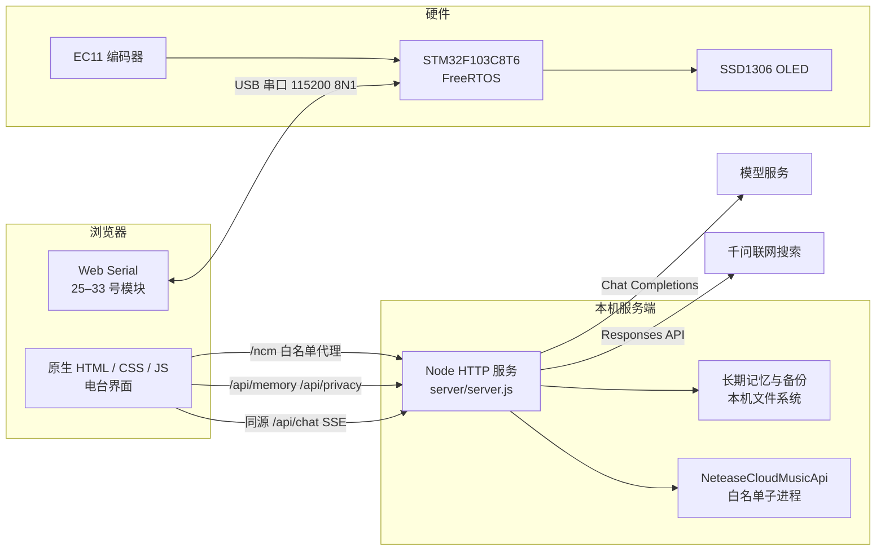

# 架构

Music Companion 由三部分组成：浏览器里的电台界面、本机 Node.js 服务端，以及通过 USB 串口连接的 STM32 硬件终端。三者都在一台电脑上运行，没有云端服务。

## 网页应用

界面是原生脚本，没有打包器。`web/index.html` 末尾按编号顺序引入 `web/js/*.js`，同一编号前缀表示加载顺序；编号不连续是历史原因，不代表缺失文件。

| 分层 | 模块 |
|---|---|
| 基础设施 | `00-storage-coordination`、`00-credentials`、`01-config`、`02-login`、`03-starfield`、`07-mascot`、`08-clock` |
| 播放 | `04-player`、`06-audio`、`10-favorites`、`13-navigation`、`14-daily`、`18-playback-queue` |
| 对话与歌单 | `09-chat`、`11-companion`、`12-conversation`、`17-music-companion`、`19-playlist-draft`、`20-playlist-library`、`21-playlist-manager` |
| 记忆与备份 | `15-memory`、`16-memory-discovery`、`22-backup-format`、`23-backup-browser`、`24-backup-ui` |
| 硬件链路 | `25-uart-protocol`、`26-web-serial`、`27-hardware-panel`、`28-app-protocol`、`29-oled-display`、`30-player-observer`、`31-oled-spectrum`、`32-device-events`、`33-title-scroll` |

浏览器状态（聊天、收藏、歌单、设置、网易云登录凭证）保存在 `localStorage`；长期记忆保存在服务端。

## 服务端

`server/server.js` 只使用 Node 内置模块，不用框架：

| 路由 | 作用 |
|---|---|
| `POST /api/chat` | 校验请求、构造人格提示词、注入记忆，转发到模型并回传 SSE |
| `POST /api/search` | 千问 Responses API 联网搜索，过滤无来源或敏感链接 |
| `/api/memory/*` | 长期记忆增删改查、自动发现、跨设备备份恢复，按浏览器身份隔离 |
| `POST /api/privacy/check` | 发送前检查文本或备份中是否含凭证 |
| `GET /api/health` | 健康检查，返回是否已配置模型 |
| `/ncm/*` | 白名单反向代理到本机网易云音乐服务 |
| 其他 | `web/` 静态文件，带目录穿越防护 |

模型 Key 只从 `.env` 或进程环境变量读取，不会下发给浏览器。音乐服务作为独立子进程启动，通过 `ncm-log.js` 只放行应用使用的接口，并删除了子进程环境里的模型 Key。

## 硬件链路

固件（`firmware/`）跑 FreeRTOS，两个常驻任务：

- `LED_Task`：PB12 状态灯 500 ms 翻转，并采样栈高水位与堆余量。
- `UART_ServiceTask`：10 ms 周期采样编码器/按键，解析串口帧，分发给协议、应用状态与显示服务。

**显示方向（网页 → 硬件）**：`30-player-observer` 轮询播放器 DOM 与 `<audio>` 进度 → `29-oled-display` 用 canvas 渲染 128×64 单色画面并打包为 1bpp 位图 → `28-app-protocol` + `25-uart-protocol` 编码为 `0x40` BEGIN / `0x41` DATA / `0x42` END 帧 → Web Serial 发送 → 固件显示服务校验会话与分片后写入 OLED。

**控制方向（硬件 → 网页）**：编码器旋转/按下 → 固件 `0xC0`/`0xC1` 事件（无 ACK、尽力而为）→ `32-device-events` 执行音量调节、暂停/继续、下一首 → 成功后用 `0x10`–`0x13` 应用命令回写 MCU 状态，保证屏幕与实际播放一致。

协议细节见 `firmware/docs/`。

## 数据流与落盘位置

| 数据 | 位置 | 说明 |
|---|---|---|
| 聊天、收藏、歌单、设置、网易云凭证 | 浏览器 `localStorage` | 同源标签页通过存储协调与修订检查同步 |
| 长期记忆 | Windows 默认 `%LOCALAPPDATA%\Zily\memory` | 按浏览器身份隔离，`HttpOnly` + `SameSite=Strict` Cookie |
| 自动备份 | 记忆目录旁的 `backups`（可用 `ZILY_BACKUP_DIR` 指定） | 带版本与 SHA-256 校验的明文 JSON |
| 程序配置 | 项目根目录 `.env` | 不进版本库 |

## 运行时约束

- 网页服务默认监听 `127.0.0.1:8080`，网易云音乐子服务监听 `127.0.0.1:3000`。
- Web Serial 只在安全上下文可用（`localhost` 或 HTTPS），并且目前只有 Chromium 内核浏览器支持。
- 项目面向个人本机单用户，不提供公网多用户鉴权。