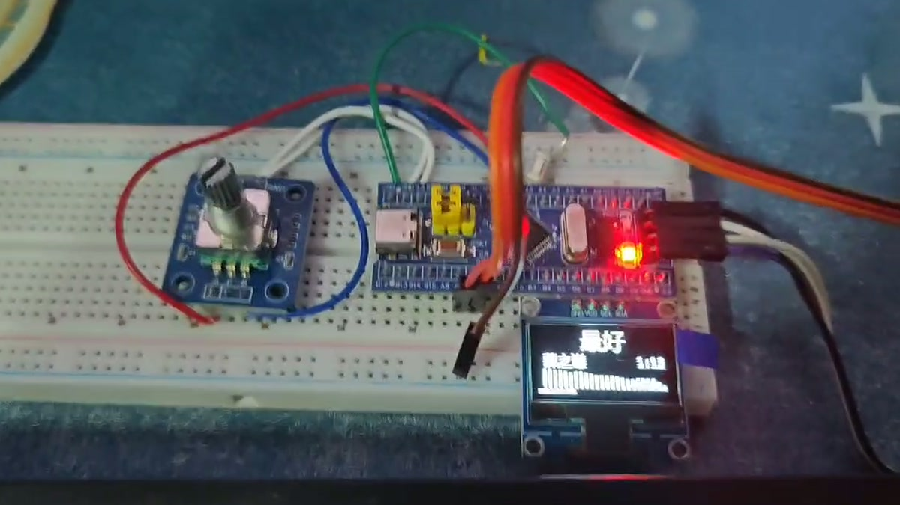

# 硬件伴侣：接线、烧录与联调

硬件终端把网页正在播放的歌曲信息、进度和实时频谱显示在一块 128×64 的 OLED 上，并提供一个实体旋钮调音量、暂停/继续、切歌。

> [观看 17 秒实机演示（无声）](media/hardware-demo.mp4)

## 物料清单

| 物料 | 规格 | 数量 | 说明 |
|---|---|---|---|
| 主控板 | STM32F103C8T6 最小系统板（Blue Pill） | 1 | 64 KB Flash / 20 KB SRAM，板载 PB12 LED |
| 显示屏 | SSD1306 0.96" OLED，128×64，I2C 4 针 | 1 | 地址 `0x3C` |
| 旋转编码器 | EC11，带按压开关，5 针 | 1 | A/B 两相 + 公共端 + 按键 |
| USB 转串口 | CH340（或 CP2102）模块 | 1 | 与主控 USART1 相连 |
| 烧录器 | ST-Link V2（SWD） | 1 | 首次烧录固件 |
| 面包板、杜邦线 | 若干 | 1 套 | 3.3V 供电，共地 |

> V1 未包含四种颜色 LED、光敏电阻和独立按键；固件里对应的驱动与演示代码已移除。主控板上自带的 PB12 LED 用作运行指示。

## 接线

| STM32 引脚 | 连接到 | 备注 |
|---|---|---|
| PA9（USART1 TX） | CH340 RX | 115200 8N1 |
| PA10（USART1 RX） | CH340 TX | 固件配置为上拉输入 |
| PB8（I2C1 SCL，重映射） | OLED SCL | 需要开启 I2C1 重映射 |
| PB9（I2C1 SDA，重映射） | OLED SDA | |
| PA6 | 编码器 A | TIM3 编码器模式 |
| PA7 | 编码器 B | TIM3 编码器模式 |
| PA5 | 编码器按键（SW） | 内部上拉，按下为低 |
| PB12 | 板载 LED | 500 ms 翻转，表示固件在跑 |
| 3.3V / GND | OLED、编码器、CH340 | 必须共地 |

编码器公共端接 GND，A/B 直接接 PA6/PA7；按键端接 PA5 与 GND。如果旋转方向与预期相反，把 `firmware/App/zily_input_service.h` 里的 `ZILY_INPUT_ENCODER_DIRECTION` 改成 `(-1)` 重新编译。

## 烧录固件

1. 按 [firmware/README.md](../firmware/README.md) 用 Keil 构建，得到 `firmware/Project/Objects/0-9A/Zily-Hardware.axf` 与 `Zily-Hardware.hex`。
2. 用 ST-Link 连接 SWD（3.3V、GND、SWDIO、SWCLK）。**首次使用要先把下载驱动切到 ST-Link**：`Options for Target`（Alt+F7）→ `Debug` 页选 **ST-Link Debugger**（Port 选 SW，能看到 SW Device 即连接正常）→ `Utilities` 页勾选 `Use Target Driver for Flash Programming` 并同样选 **ST-Link Debugger** → OK。工程默认是 ULINK2，不改会在下载时报找不到设备。
3. Keil 中 **Flash → Download（F8）**；或 Debug → Start/Stop Debug Session 后下载；也可用 STM32CubeProgrammer（ST-Link + SWD）烧写 hex。
4. 复位后串口应输出 `ZILY UART1 READY`，PB12 开始闪烁。
5. 默认构建屏幕是空白的（等网页下发首帧）。想在没有电脑时检查 OLED 接线，把 `firmware/App/main.c` 的 `ZILY_BOOT_SELFTEST` 改为 `1` 重新编译，开机会跑约 2 秒图案自检。

## 启动网页并连接设备

1. `npm.cmd start`，用 Chrome 或 Edge 打开 `http://localhost:8080`（Web Serial 需要安全上下文，`localhost` 满足条件；Firefox/Safari 不支持）。
2. 左侧「电台设置 → 硬件调试」打开硬件面板。
3. 点「连接设备」，在浏览器弹窗里选择 CH340 对应的串口（设备管理器可见）。首次授权后可用「恢复已授权设备」免弹窗重连。
4. 面板会显示设备状态、输入事件与最近通信日志；「发送 PING / ECHO」用于验证链路。

## 面板功能

| 区域 | 作用 |
|---|---|
| 连接 / 恢复 / 断开 | 管理串口会话；同一浏览器同一时间只允许一个标签页占用端口 |
| 应用命令 | PAUSE / RESUME / NEXT / FAVORITE，仅同步 MCU 状态，不反向控制网页播放 |
| OLED 显示 | 「跟随播放」自动推送歌名、歌手、时间、进度与频谱；「测试 OLED」显示内置测试屏；可暂停跟随 |
| CRC16 / SEQ | 最近一帧的校验值与序号，便于排查 |
| 最近通信 | 收发帧的时间线日志 |

## 预期效果

- 网页播放歌曲后，OLED 显示中文歌名、歌手、时间与进度条，长歌名会自动滚动。
- 播放中频谱约 8 Hz 跳动；暂停时冻结在最后一帧。
- 旋转编码器：音量每档 ±5%；单击暂停/继续；快速按两下下一首。
- 拔插 USB 或复位设备后，面板「恢复已授权设备」并重新开始跟随即可恢复显示。

## 常见问题

| 现象 | 排查 |
|---|---|
| 浏览器没有「连接设备」或点不开选择框 | 换 Chrome/Edge；确认页面来自 `localhost` 或 `127.0.0.1`，不要用局域网 IP |
| 串口列表里没有设备 | 装 CH340 驱动；换数据线（部分线只供电）；确认设备管理器里出现 COM 口 |
| 连接成功但屏幕不亮 | 检查 PB8/PB9 接线与 I2C 重映射；用 `ZILY_BOOT_SELFTEST=1` 构建确认屏能显示；OLED 供电 3.3V |
| 屏幕有字但花屏/缺行 | 检查 I2C 上拉与线长；降低杜邦线长度；确认 OLED 控制器确实是 SSD1306 |
| 旋转方向相反 | 修改 `ZILY_INPUT_ENCODER_DIRECTION` 为 `(-1)` |
| 单击没反应或一次变两次 | 单击有约 280 ms 判定窗口；确认按键接 PA5 且按下为低电平 |
| 显示更新期间按钮短暂禁用 | 设计如此：显示传输分片优先，应用命令在间隙重试 |
| 串口被占用 | 关闭串口助手或其他占用该端口的页面；同一浏览器只允许一个标签页持有端口 |

## 协议与固件文档

| 文档 | 内容 |
|---|---|
| [firmware/README.md](../firmware/README.md) | 固件构建、目录结构、主机测试 |
| [firmware/docs/README.md](../firmware/docs/README.md) | 协议总览与阅读顺序 |
| [0-4C 串口帧格式](../firmware/docs/0-4C-UART-Protocol.md) | `A5 5A` 帧、CRC-16/CCITT-FALSE、PING/PONG/ECHO |
| [0-7A 应用命令](../firmware/docs/0-7A-App-Protocol.md) | TYPE 分配、APP_ACK、状态同步 |
| [0-8A OLED 显示](../firmware/docs/0-8A-OLED-Display-Protocol.md) | BEGIN/DATA/END、1bpp 位图、区域刷新 |
| [0-9A 编码器输入](../firmware/docs/0-9A-Input-Event-Protocol.md) | 0xC0/0xC1 事件、单击/双击窗口 |